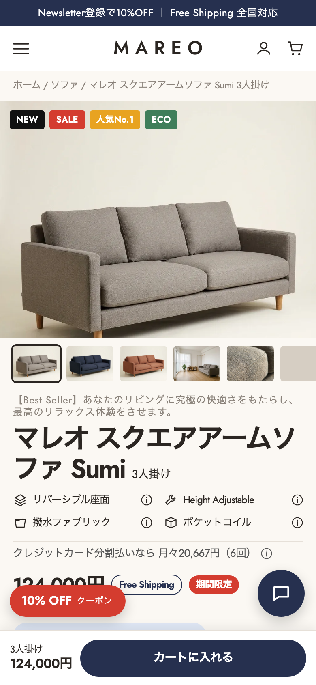
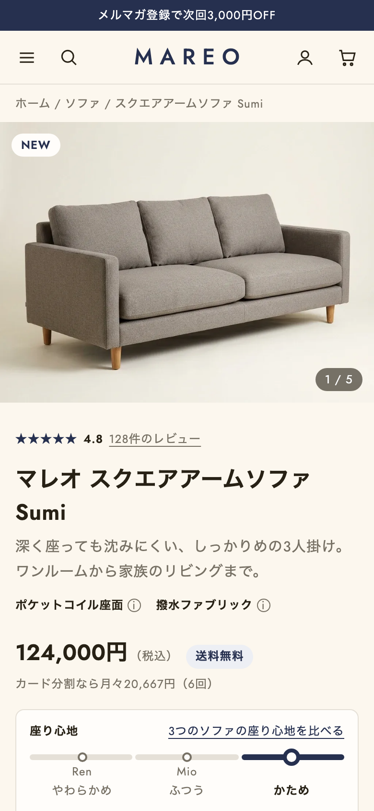

# Example: the reference review, recreated on a fictional store

This product-review kit was built to match one reference review: a Japanese-market UX/UI review
made of four documents (an index, a localisation review, an information architecture analysis and
a proposed product page). This example is that review
recreated on a fictional store. The four documents keep the reference's sections, order,
components and density of argument; the store, its problems, the evidence and the benchmarks are
made for this example.

It is not the output of a kit run. It shows what the kit is aiming at.

| Before | After |
|---|---|
|  |  |

## The store

| | |
|---|---|
| Name | Mareo / マレオ, a Danish sofa brand (Mareo ApS, Copenhagen) selling in Japan through a Japanese storefront built on its Danish Shopify template |
| Product reviewed | スクエアアームソファ Sumi: 2-seat, 3-seat and couch (98,000円, 124,000円, 152,000円), in grey, navy and terracotta. Sister sofas Ren and Mio appear in the menu and the comparison |
| Palette | Navy actions (#26304F) on the warm cream of the product photography (#FCF7EE), one terracotta accent (#A65F43) |
| Type | Jost for the MAREO wordmark and Latin product names; Japanese text in Hiragino Sans, Noto Sans JP and Yu Gothic at line-height 1.7 |
| Radii | 6, 9 and 12 px |
| Photos | Five generated images in `site/images/` (WebP for the pages, PNG originals): the sofa in three colours, a living room and a fabric close-up. Both pages use the same files |

The design system (`system/`) was derived from the brand file and validated for contrast, scale
and surface relationships.

## What's in the package

| File | What it is |
|---|---|
| `index.html` | Start here: the three documents, four key messages, how to read the markers, how the review was made |
| `mareo-jp-localisation-review.html` | 13 findings in three perspectives, each with marked evidence, a Japanese site that does it well and a proposal; what already works; market context; a global cross-check; next steps; appendix |
| `mareo-jp-ia-analysis.html` | Navigation compared with LOWYA, a product-page map, eight shopper journeys, IA findings and items to confirm |
| `mareo-jp-mock-pdp-mobile.html` | Current and proposed product page side by side, with every change explained |
| `site/before.html`, `site/after.html` | The store's product page before and after, at 390 px. On the before page, `?state=menu`, `menu-sofa`, `search` (with `&q=`), `popup`, `size`, `spec` or `deliv` opens each state. The after page is generated from the mock |

## Scope

The review is set at a 390 × 844 phone screen, and "first screen" means that size throughout. On a shorter phone, such as 375 × 667, the proposed price falls just below the first screen.

The reference covered six pages. This example covers the product page, the header, the menu
drawer and search. Sections of the reference that need a homepage or a category page are kept in
place and marked "out of scope in this example" rather than dropped.

## Sources and benchmarks

General Japanese market figures and the global cross-check (Apple, Dyson and Nike Japan) are
carried over from the reference review, with their sources. Every furniture benchmark (LOWYA, unico,
Re:CENO, ACTUS, IKEA Japan, NOYES) was checked live on 18 November 2026, and the typography table
was measured on those pages. Red values in the mock stand in for facts a store would have to
confirm.
